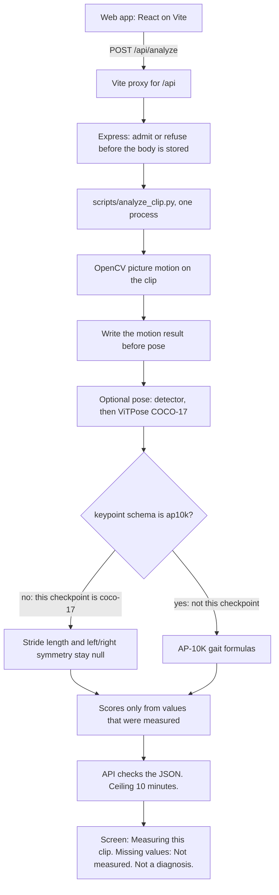

# Judges overview

SilverPaws AI is a web app that turns one short pet video into a dated observation. The repository also uses the name PetLens AI on the analysis screen, the PDF, and the phone tree. **Needs the student's confirmation:** which name is the submission title.

The app measures visible picture motion on every clip. When PyTorch and the cached weights are present, it can also place the checkpoint's 17 COCO joint labels on a detected dog. It does not diagnose pain or injury. This pose head does not measure stride length or left/right gait symmetry.

This page describes the code on `main`. It does not claim a user count, a clinical study, or an accuracy percentage. No accuracy number is stated here because this repository has not published one for pet dogs.

## Needs the student's confirmation

- Congressional district. It is unknown from this repository. Official rules allow the district where the student lives or the district where the student attends school, and only one district. Source: [2026 CAC Rules PDF](https://www.congressionalappchallenge.us/wp-content/uploads/2026/05/2026-CAC-Rules.pdf), section 1.
- Whether the student is enrolled in middle school or high school on October 26, 2026, and whether any teammates meet the team rules (at most four students, at least half eligible in that district). Unknown here.
- Who wrote which part of the app. This document does not assign contributions.
- The submission title, the one-sentence purpose the student will say on camera, and the target audience in the student's own words.
- Whether the app was created after October 30, 2025. Git history is not that statement.
- Which clock time the live submission portal enforces. See the deadline note below.
- Whether the demo will be a clip the student has rights to film, or the in-app sample. The sample is labeled `Sample data — not your pet` and is not a measurement.
- The AI disclosure the student will actually submit. The project draft is `docs/AI_USE.md`. The student must check that it matches the tools they used. Official rules permit AI only with full disclosure, and AI must not be the entirety of the work. Source: 2026 CAC Rules PDF, section 3.

## Official challenge facts used here

Sources read for this page:

- [2026 CAC Rules PDF](https://www.congressionalappchallenge.us/wp-content/uploads/2026/05/2026-CAC-Rules.pdf) (May 2026 file on the challenge site)
- [Rules page](https://www.congressionalappchallenge.us/students/rules/)
- [Student registration page](https://www.congressionalappchallenge.us/students/student-registration/)

The PDF says submissions run from May 2026 through October 26, 2026, at 12:00 pm EDT. The registration page says the deadline is scheduled for October 26, 2026 at 9:00 pm ET. The rules page names October 26 and does not give a clock time. Those pages disagree. This document does not pick one. **Needs the student's confirmation** against the portal they will use.

Other rules from those pages, not invented here: any language or platform; U.S. residents, no citizenship requirement stated on the rules page; one app per student per year; a public YouTube or Vimeo demo of 1–3 minutes that names the participants, the app, a one-sentence purpose, the audience, the tools and languages, and the functionality; judging described as idea quality, implementation, and coding, with the Member of Congress able to change the process. Winner announcements are made by the Member's office. The challenge site says it cannot announce 2026 results before January 15, 2027.

## What a judge is looking at

The web client is React on Vite. The API is Express. Analysis is Python (`gait_engine` and `scripts/analyze_clip.py`) using OpenCV for picture motion and, when installed, a COCO detector plus ViTPose++ base. Saved observations stay in the browser. The clip is written to a temporary folder for analysis and removed after the request.

The phone tree under `mobile/` is in the repository. This overview describes the web path. It does not claim the phone app was exercised for this page.

## Architecture

Each analysis is one Python process. There is no warm model worker in this path. The browser does not abort the request at four minutes. The service ceiling is `ANALYSIS_TIMEOUT_MS`, default 600000 milliseconds (10 minutes). Motion is written before pose starts. If pose does not finish, that saved picture-motion result can be returned. At the ceiling the API stops the Python process group.

Detector id: `PekingU/rtdetr_r50vd_coco_o365`. Pose id: `usyd-community/vitpose-plus-base`. The dog and person class ids are read from the detector config labels. The score threshold is 0.3. A person box is noted. It is not used as the dog box.

The detector runs every 5 sampled frames. Frames in between are empty observations. The tracker does not copy the last box into a gap. Overlap below 0.1 does not keep the same identity. A gap longer than 5 frames starts a new segment. Two plausible dogs return no box for that frame. Pose runs only on an accepted box.

Dataset index 3 selects a backbone expert. It does not emit AP-10K keypoints. Channel 4 is the right ear (`right_ear` in code, `r_ear` in the checkpoint label list). It is not a paw, hock, neck, or tail base.

Sampling aims at 15 frames per second and keeps at most 20 seconds: the window with the highest motion coverage, not automatically the first frames.

## Supported and unmeasured

Supported when the clip can be decoded:

- Picture motion: mean, spread, and coverage, plus duration and frame count.
- Movement-consistency and activity scores when the signal is usable. They come from those motion numbers.
- An overall indicator blended from the factors that exist. Missing factors are left out. They are not stored as zero.
- When pose runs: 17 COCO joint positions and confidences, mean confidence, whether a dog was in frame, whether a person box was seen, and track-segment diagnostics.

Unmeasured on this checkpoint. The stored value stays null, and the screen says "Not measured", not 0:

- Stride length and body-length stride.
- Left/right gait symmetry and the stride-symmetry score.
- Cadence, stride counts, and stride-interval variation. Those formulas are for an AP-10K array.
- Hip extension and stifle flexion. The report text says they are not computed.
- Neck and base of the tail. This head has no such points.
- Mobility, when it depends on stride timing or bob/pelvis asymmetry that this head does not compute.
- A change-from-last-walk factor on the first clip, or when the previous clip used a different pipeline.

A result with almost no motion, or too few frames, does not publish scores.

## 30-second pitch

Say this in the student's own voice. Replace the bracketed name.

"[Name]. This is SilverPaws, a web app for a pet owner who wants a dated record of one short walk video. It measures how much the picture moves, and, when the model weights are installed, it marks 17 standard COCO body points on the dog it detects. It is not a diagnosis. This pose model does not measure stride length or left-right symmetry, because it has no neck and no base of the tail. The owner can save the note and compare a later walk that was measured the same way."

**Needs the student's confirmation** before recording: the spoken app name, the audience sentence, and that this purpose matches the app they want judged.

## Two-minute demo script

Aim for about two minutes. The official video limit is 1–3 minutes, public on YouTube or Vimeo. Say every required item out loud: participant names, app name, one-sentence purpose, audience, tools and languages, and a real function.

| Time | Do and say |
| --- | --- |
| 0:00–0:20 | Names, app name, one sentence of purpose, who it is for. Name the tools: React, Vite, Express, Python, OpenCV, and the COCO detector plus ViTPose weights when they are installed. |
| 0:20–0:45 | Open the analyze screen. If showing "Try Sample Dog Walk", say immediately that the banner is sample data and no video was analyzed. Prefer a clip the student filmed and has rights to show. |
| 0:45–1:15 | Start an analysis. Point at the status "Measuring this clip". Say the request is still working. Do not describe a four-minute abort. The service limit is 10 minutes, and a picture-motion result can return if pose does not finish. |
| 1:15–1:40 | Open the result. Read one motion number that is actually on screen. Then read a field that says "Not measured", such as stride length or stride symmetry. Say that "Not measured" is not zero. |
| 1:40–2:00 | Read the non-diagnostic line: the result is visible movement only and is not a diagnosis. If pose points are on screen, say they are COCO-17 human joint labels, and channel 4 is the right ear. Stop. Do not invent a medical conclusion. |

If the pose weights are not installed on the demo machine, say that, and show the picture-motion result. Do not imply the pose model ran.

## Limitations to say plainly

- Not a veterinary device and not a diagnosis. A score cannot rule pain in or out.
- The pose head is COCO-17. It is not a validated canine skeleton. Pose quality on pet dogs is not proven by an accuracy number in this repository.
- Stride length and left/right symmetry are unmeasured on this head.
- The in-app sample uses display numbers, including a symmetry score, and its note says no video was analyzed. Those numbers are not evidence.
- One clip, one camera angle. The analyzer keeps at most 20 seconds.
- Pose runs in the request process. The first load includes reading weights. This page does not quote a timing from another machine as this demo's timing.
- `python scripts/check_setup.py` does not report CPU or CUDA and does not download weights. It only reads the local cache.
- An optional language-model rewrite can reword the note only when the server is configured for it. It is not required, and it does not change the measured numbers.
- Phone-file rotation handling is described in code as not checked on a real phone file in the environment that wrote that comment.

## Likely judge questions

**Did you use AI?** Yes, if the detector, the pose model, or a configured language-model rewrite ran, and also if coding tools were used. Point at `docs/AI_USE.md` and at the disclosure the student submits. The motion measurement is OpenCV frame differences, not a learned model. Scores come from fixed formulas. **Needs the student's confirmation** of which coding assistants they used. This document does not list them.

**How accurate is the pose model?** Do not give a percentage. Say the checkpoint outputs 17 COCO joints, channel 4 is the right ear, and pet-dog accuracy has not been established here. A visual check procedure is in `docs/pose-validation.md`. The pixel notes there are one side-view review, not a benchmark.

**Why are stride and symmetry blank?** The gait formulas index an AP-10K skeleton, including the base of the tail at channel 4. This head's channel 4 is the right ear. Running that math would mis-label the head. The values stay null.

**What did you code versus what did the model do?** The student should answer with their own work: upload checks, the web screens, the API, the motion path, the schema guard, and the decision not to print missing metrics as zero. The detector and pose weights are existing published models loaded by id. **Needs the student's confirmation** of their personal share. Do not invent it.

**Is it accessible?** Do not claim a conformance level. None is established in this document.

**Where are the weights?** `HF_HOME`, or `models/hf` in the repo. The setup command only looks. It does not download. There is no checkpoint URL in the setup check.

**What if two dogs are in frame, or the dog leaves?** Ambiguous pairs produce no box. A gap with no overlap does not keep the old box. A long gap starts a new segment.

## Real-dog validation protocol

Do this with a dog the student has permission to film. Do not treat the result as medical ground truth. Do not commit the video.

1. Film from the side. Keep one dog's whole body in frame. Note the location, the date, the clip length, and whether a person is in frame. Write a one-sentence description of what the dog did before opening the result.
2. Run `python scripts/check_setup.py`. Record Python, OpenCV, whether both weight files are present, the pose schema, and channel 4. Confirm channel 4 is the stored ear label, not a renamed joint. The command will not print CPU or CUDA.
3. Analyze the clip in the web app, or with `scripts/analyze_clip.py`. Record the pipeline name (`opencv-motion` or `dog-pose`), the signal note, and the status text while it runs.
4. On the result, list every field that is a number and every field that says "Not measured". On this checkpoint, stride length and left/right symmetry must stay unmeasured. A zero in those fields is a defect, not a finding.
5. If pose ran, check the keypoint names against the COCO-17 list. Channel 4 must be the right ear. Use `python scripts/check_pose_backend.py` as described in `docs/pose-validation.md` for a drawn-frame look. Do not score a nose-to-tail length.
6. Compare the result only to the sentence written in step 1: was the dog moving, still, or hard to see? Agreement on that question is a sanity check. It is not an accuracy rate.
7. Optional second clip of the same dog, measured with the same pipeline, if the student wants to show the history comparison. A first walk has no historical-change score. That absence is null, not zero.
8. Write down what failed: missing weights, timeout with motion only, ambiguous track, or a joint that landed off the body. Keep that note with the submission. Do not convert it into a percentage.

`validation_clips/labels.csv` is a place for labels the student already has (`normal`, `mild`, or `significant`). This overview does not claim that file has been filled or scored.
